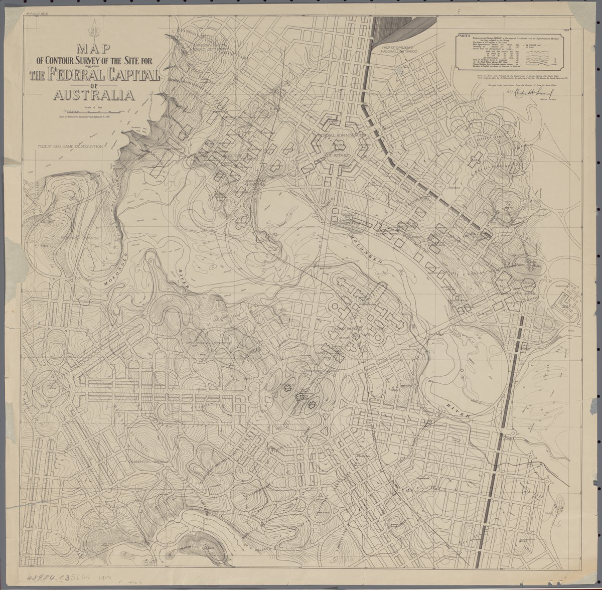
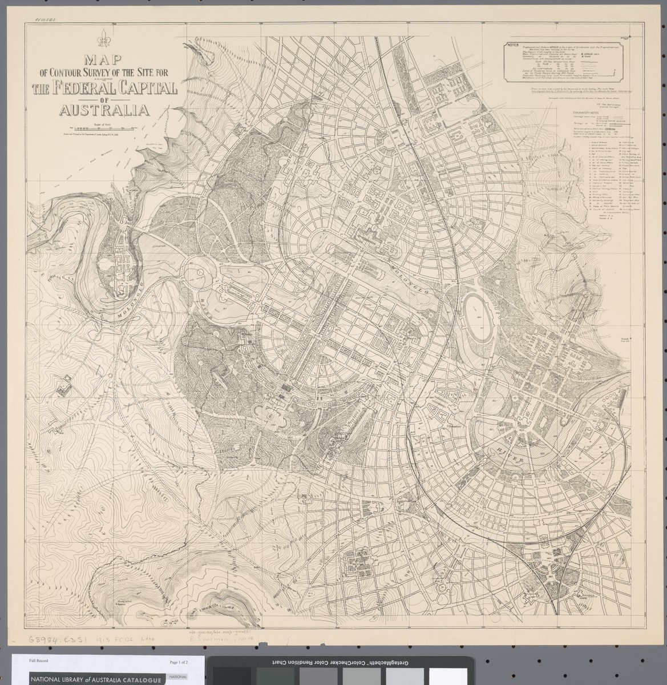
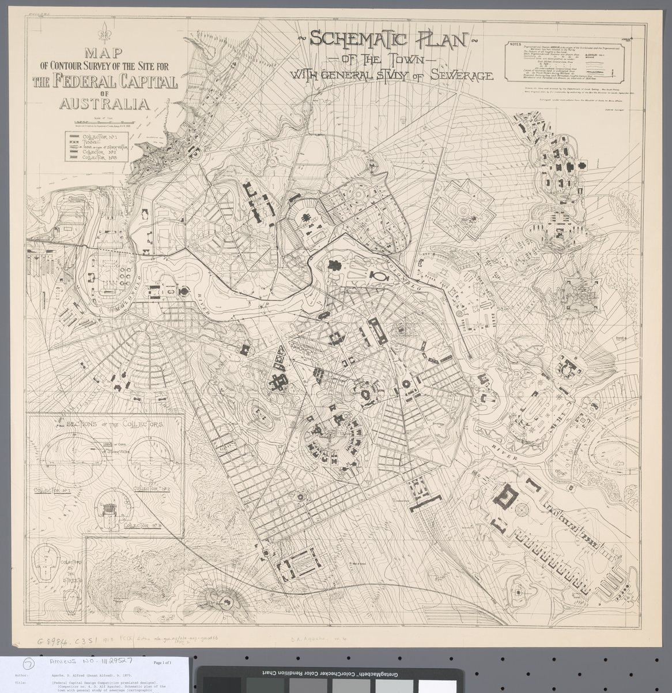
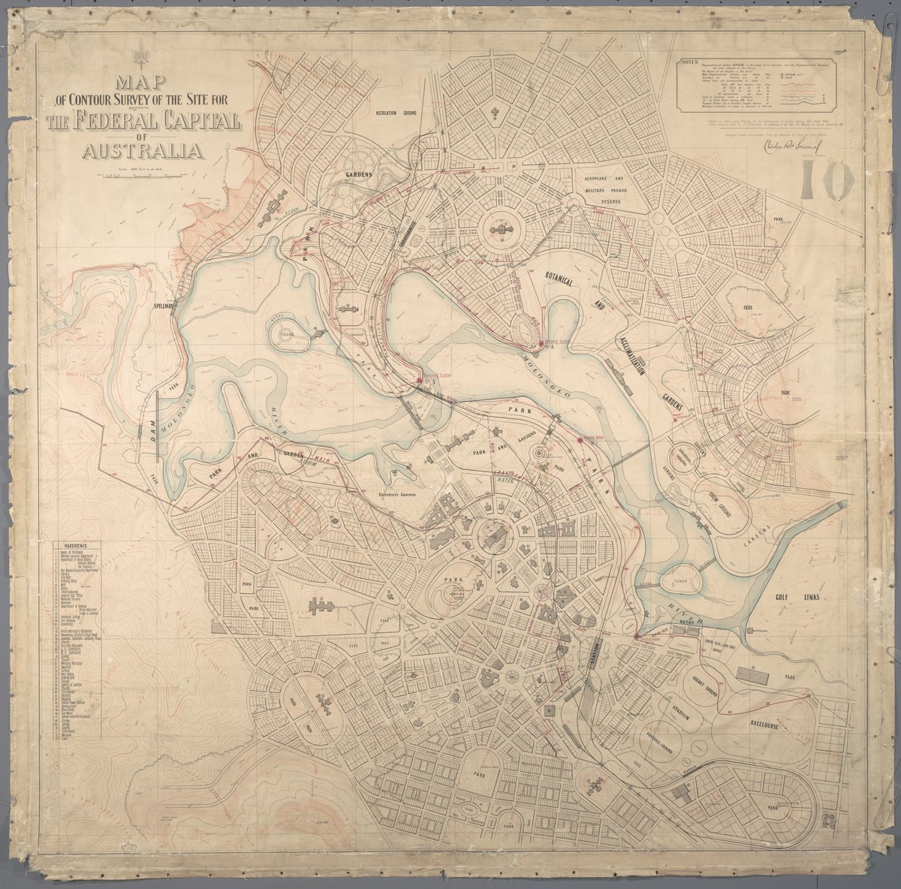
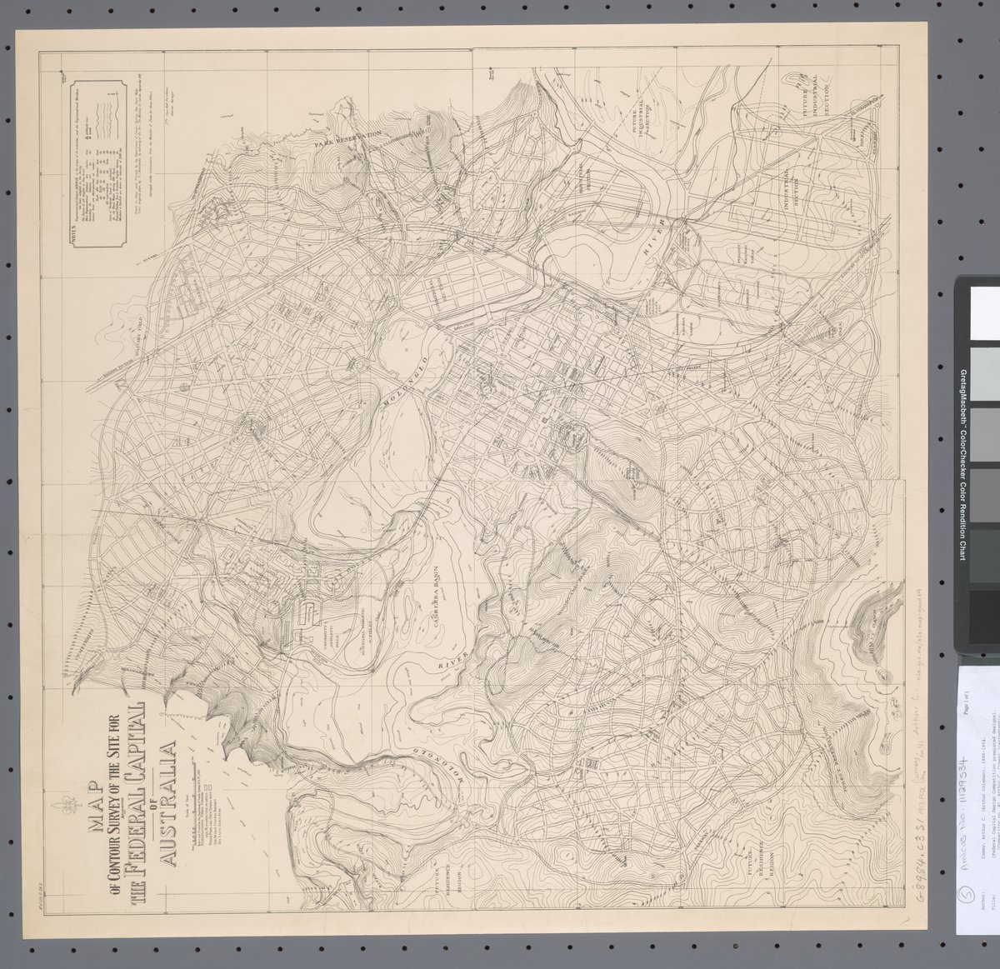
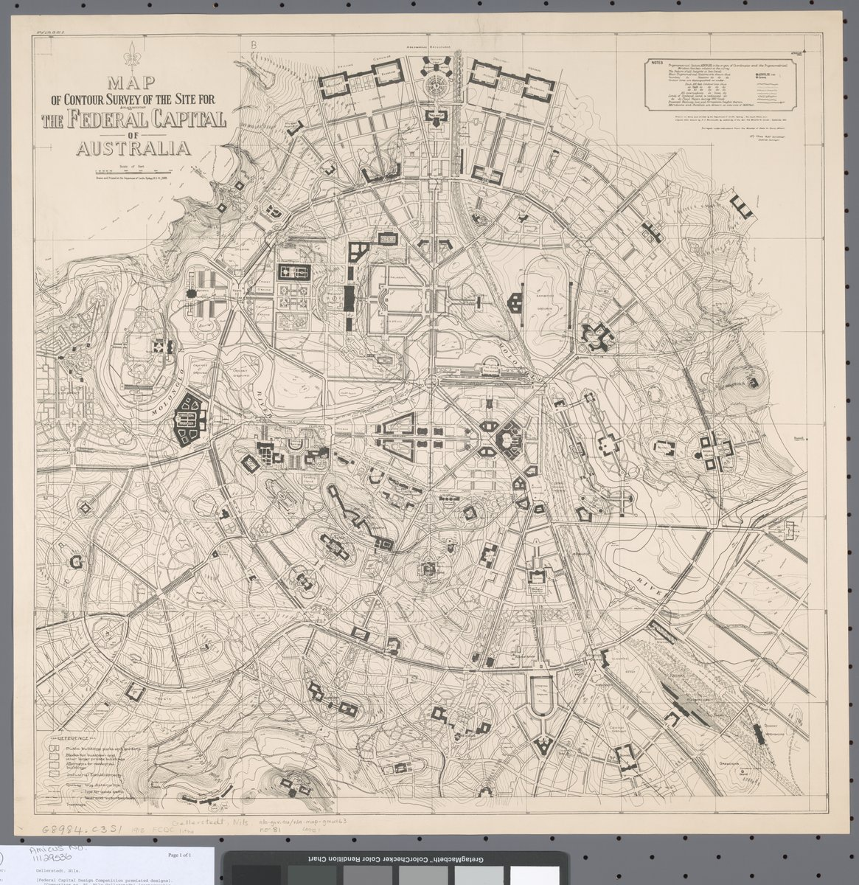
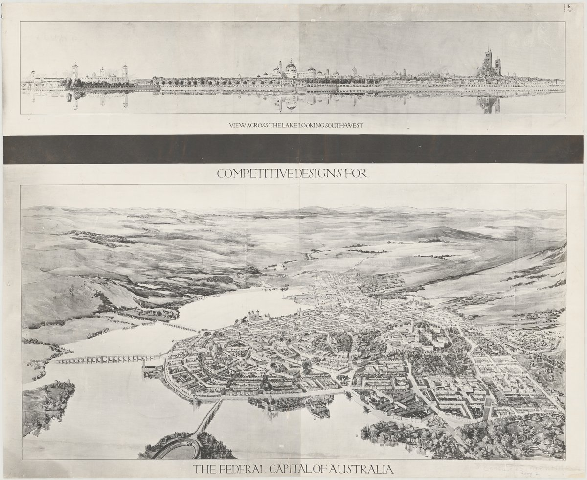

# The competition for a capital

In 1911 the Commonwealth of Australia asked the world to design its capital city.
It had a site, a sheep-run on the Limestone Plains beside the Molonglo River, and almost nothing else.
One hundred and thirty-seven designs came back.
This is the story of how they were judged, how the judges fell out, and how one surveyor in Sydney thought they had chosen wrongly.

The sources it rests on are listed in [sources.md](sources.md).

## The site and the survey

The site was chosen before any designer saw it.
By the account of Charles Caswell, one of the competitors, the honour of finding it was due to Colonel Vernon, and the position adopted was the choice of a board of three: Vernon, Colonel Miller and the surveyor Charles Scrivener.

Scrivener's survey is the thread that ties the whole competition together.
His *Map of Contour Survey of the Site for the Federal Capital of Australia*, printed in four sheets by the New South Wales Department of Lands in September 1910 and signed "Charles Robt Scrivener, District Surveyor", was issued to every competitor.
It is drawn on a flat grid in feet, counted west and south of the trig station on Mount Ainslie, with lines ruled every 2,500 feet.
Most of the entries were drawn straight onto it.
That is why, a century later, they can be laid on the ground again: find the grid on a plan, and the plan falls into place (see [`georef/`](../georef/README.md)).

## The call for designs

The rules were set out in a booklet, *Information, Conditions and Particulars for Guidance in the Preparation of Competitive Designs for the Federal Capital City of the Commonwealth of Australia*.
It was dated 30 April 1911, and its twelve pages are [transcribed here](transcriptions/1911-information-conditions-and-particulars.md).

The prizes were £1,750, £750 and £500.
Entries were due in Melbourne by 31 January 1912, unsigned, with the author's name sealed in a packet that only the Governor-General would open.
Every general plan had to be drawn on the official contour map.

The booklet asked for a city of 25,000 people that would keep growing with the nation.
It listed the buildings the city needed, from a Houses of Parliament with a 600-foot frontage, "a dominating feature of the city", down to a gaol, a gas works and a stadium.
It asked for railways, tramways, an ornamental lake on the Molonglo and a scheme for storm water, and it told competitors to embody "all recent developments in the science of town planning".
The rest is a description of the site: its hills, its floods, its winds and the views from its trig stations.
The judging was to be done by a board, but the last word belonged to the Minister for Home Affairs, King O'Malley.
That arrangement kept many architects, in Britain especially, from entering at all.

## The judging

The Federal Capital Designs Board was gazetted on 2 March 1912.
It had three members: J. M. Coane, a licensed surveyor, in the chair; James Alexander Smith, an engineer; and John Kirkpatrick, an architect.

In the ballroom of Government House in Melbourne they were shown 137 designs.
Eleven were thrown out because they gave away who had drawn them.
The rest came to some five hundred drawings, with photographs, models, specifications and descriptions.
The Board weeded out the weaker plans, photographed the remainder, and took the photographs to the site at Yass-Canberra to compare them with the ground.
Back in Melbourne it narrowed the field to six, and there it stuck.

*"Further reduction has not been found practicable,"* the report says, with some restraint.

Smith and Kirkpatrick placed design No. 29 first, No. 18 second and No. 4 third.
Coane would have none of it.
In a letter of his own he named No. 10 first, No. 41 second and No. 81 third.
The two sides had not a single design in common.

On 23 May 1912 O'Malley sided with the majority.
When the sealed envelopes were opened, the winners were Walter Burley Griffin of Chicago, Eliel Saarinen of Helsingfors (Helsinki) and Alfred Agache of Paris.

| No. 29: Walter Burley Griffin | No. 18: Eliel Saarinen | No. 4: Alfred Agache |
| --- | --- | --- |
|  |  |  |
| First prize, £1,750 | Second prize, £750 | Third prize, £500 |

Coane's three were an Australian team, W. Scott Griffiths, Robert Coulter and Charles Caswell of Sydney; Arthur Comey, a landscape architect of Cambridge, Massachusetts; and Nils Gellerstedt, a civil engineer of Stockholm.

| No. 10: Griffiths, Coulter & Caswell | No. 41: Arthur Comey | No. 81: Nils Gellerstedt |
| --- | --- | --- |
|  |  |  |
| Coane's first | Coane's second | Coane's third |

The majority also commended two more: No. 7, by Harold Van Buren Magonigle of New York, and No. 35, by Schanfelberg, Rees and Gummer of London.

Most of these images are the lithographs that the New South Wales Department of Lands made in 1913, when it redrew the named designs onto the contour survey for the Board's report.
No. 10 is the exception: the authors' own hand-coloured drawing, 133 centimetres square, which the National Library holds.

## A surveyor's dissent

In July 1912 the designs were shown for a few days at the Sydney Town Hall.
Among the visitors was L. A. Curtis, President of the Institution of Surveyors, New South Wales, who had spent thirty-six years in the profession.
On 20 August he read the Institution a paper on what he had seen, and *The Surveyor* printed it at the end of the month.
Tom Griffiths has transcribed it in full: [1912-curtis-the-federal-capital-designs.md](transcriptions/1912-curtis-the-federal-capital-designs.md).

Curtis's complaint was that the Board had judged drawings, not cities.

> Naturally, those which stand out at first glance are the ones in which draftsmanship excels … But it does not by any means follow, as surveyors well know, that a pretty drawing is the best suited to the conditions. … The practical is overshadowed by the beautiful on paper, and the best workable design is relegated to the background, while the impracticable one gets the prize.

He was not surprised by the split.
The Board, he pointed out, held one architect, one engineer ("not a civil engineer, but a mechanical one, I understand") and one surveyor, and the dissent had come from the surveyor.

He went through the winners one by one.
Griffin's design he called "bold and attractive", but he disliked its railway, moved to the edge of the town and run through a tunnel, with "no less than 26" streets crossing it.
Its avenues would climb at 1 in 9 or 1 in 10, and drainage had "received no consideration at all".
And he could not see why the Gaol should stand beside the City Hall:

> What would we say in Sydney, or Melbourne, if the Gaol were situated in Martin Place, or in Collins Street.

Saarinen's plan he thought beautiful and impossible:

> Just imagine the cutting away of hills and filling up of hollows, 50 to 60 feet in depth, in order to flatten out a city site to suit a plan.

Agache, for the sake of symmetry, had run a street along a drop so steep that one side of the road stood 35 feet below the other.
"However," Curtis added drily, "he was right, for he got the 3rd Prize."

For No. 10 he had nothing but praise.
It had been "prepared to fit the site", and "its practicability is far and away above any of its competitors".
He thought it would be as beautiful as Griffin's, easier to lay out and cheaper to keep.

Curtis looked at thirty-odd designs in all, and some of them he enjoyed rather too much.
No. 61 gave him "the idea of a competition for a postage stamp".
No. 69 a bystander likened to "a drunkard's dream, perhaps because of its general likeness to a number of purple entwined snakes".
No. 73 seemed to have been "conceived in a sausage factory", No. 139 to be meant "for the glass dome of a crystal palace", and No. 140 "would make a good chessboard if the number of squares were largely reduced".
No. 100, pasted over with newspaper cuttings of motor cars and buildings, was "the joke of the exhibition".

He had kinder words for No. 15, from England: "an effective design", though it covered only the middle of the site.
It was Ernest Gimson's, and the Library now holds only his two perspective views.

*No. 15, Ernest Gimson: "View across the lake looking south-west", and a bird's-eye view of the city.*

Curtis ended with the city he hoped for:

> It will be the show city of Australia, and its principal object is the beautiful. Its buildings must be good; its parks and gardens must be good; its streets must be wide and easy, and well chosen. … And in the formation and building of this great Southern Capital we have the opportunity before us now of creating the most beautiful and well thought out city in the world.

## The authors of No. 10 reply

Charles Caswell spoke next, for the three authors of No. 10.
He made a striking admission.
They had begun with almost exactly Griffin's idea, a formal plan of avenues radiating from the hills, and had given it up, because its rigidity cost too much in gradients.

He took Kurrajong, the hill Griffin had chosen for his Capitol, as his example.
His team had found the only rational way up it to be a spiral road at 1 in 20, and had made the hill a park with a monument on top.

> We regard any attempt to destroy the contour of this prominent feature as little short of vandalism.

They had worked as a syndicate, convinced that "*no one man* could successfully design the Federal City".
He ended on a note of hope: "We still adhere to a fervent trust, however, that the Australian Federal City at Canberra will be created upon an Australian design."

## What became of them

Both men were sure of the future, and both were wrong.
Curtis did not think it probable "that any of the three winning designs will ever materialise".
Caswell predicted that "history will yet record the truth of Mr. Coane's judgment".

Griffin's plan is the one that was built, though slowly, and much changed along the way.
He came to Australia in 1913 to carry it out.
The lakes he drew on the flood plain of the Molonglo were made at last in 1964, and bear his name.
His Capitol on Kurrajong never rose; the hill is Capital Hill now, and since 1988 Parliament House has stood cut into it.

The other designs went into archives and libraries.
This repository brings some of them out again: their streets traced from the plans, laid on the ground they were drawn for, and set beside the city that was built instead.

- [`sources.md`](sources.md) lists every source in this folder.
- [`../georef/`](../georef/README.md) lays the 1910 survey and eleven of the plans on the modern map.
- [`../demos/`](../demos/) has a map to explore them, and Canberra Visions, a 3D sketch you can walk through.
